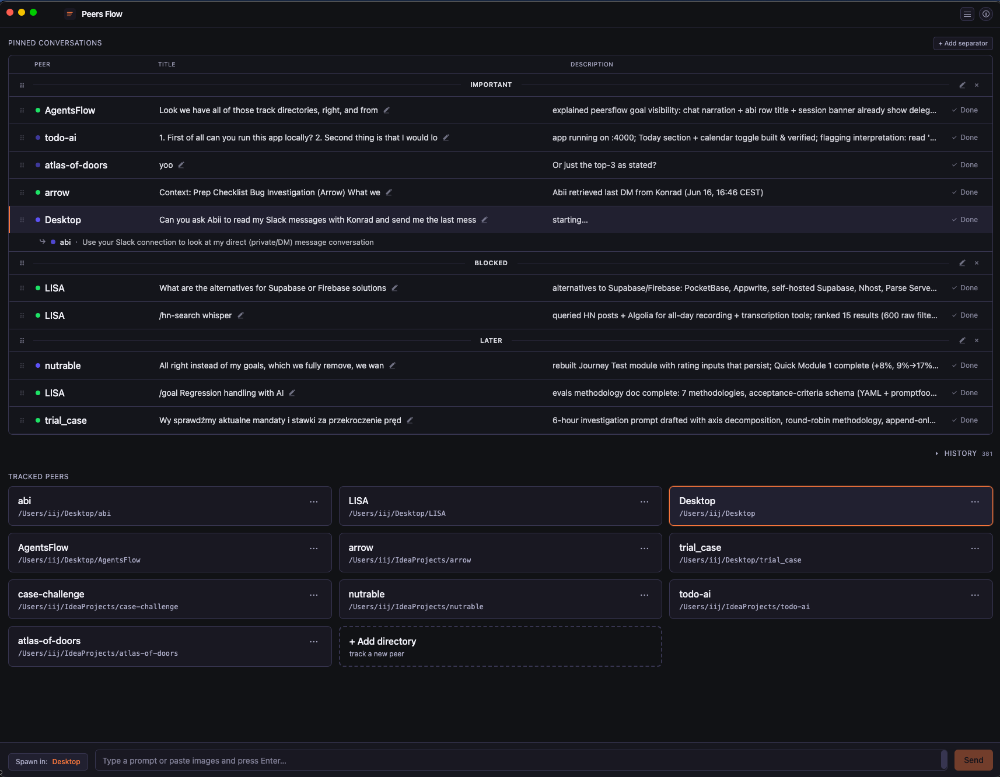
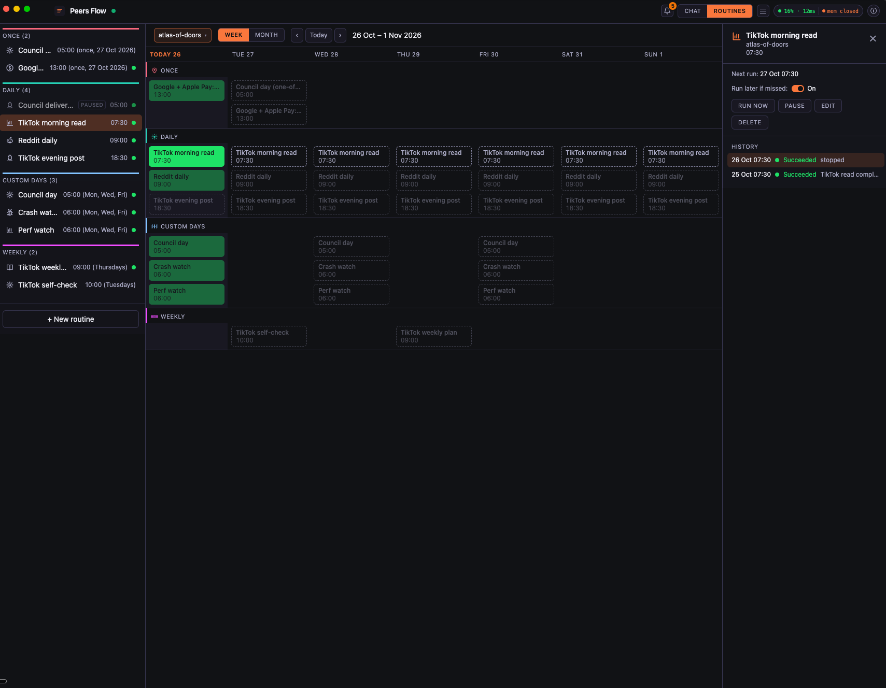
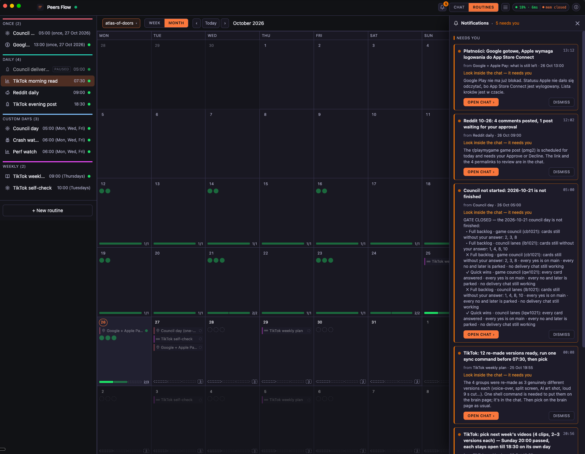
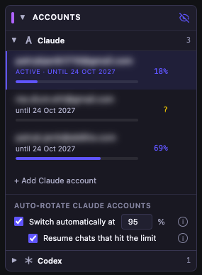
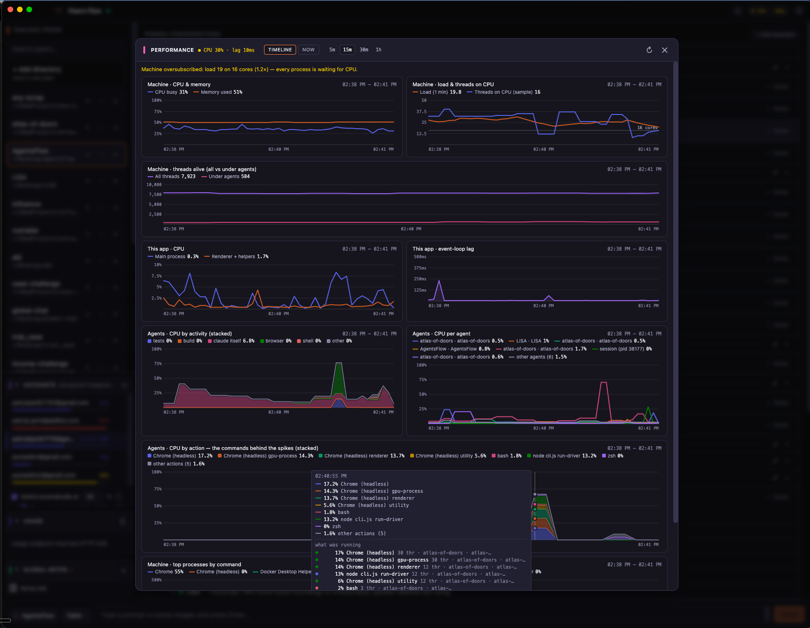

# Peers Flow



Electron + Next.js desktop UI for **Claude Code and Codex agents** — track the sessions this app launches, treat them like a to-do list, inspect each one's working tree without leaving the window, and let your agents **delegate work to one another across directories**.

> Status: early. Built against Claude Code CLI **v2.1.139+** (`claude agents` / `claude --bg`).

## Codex support

This contribution branch adds Codex alongside Claude. Choose the provider in the
composer; Codex uses your existing CLI sign-in and configured model, with an optional
model override. Chats keep running while you browse other peers, and support streamed
responses, approvals, stop, saved history, and forks. The `delegate` tool accepts
`provider: "claude"` or `provider: "codex"`; omitting it inherits the caller's provider.

A conversation stays on the agent it was started with. **Fork to Codex** / **Fork to
Claude** starts a new conversation on the other agent, seeded with a condensed
transcript of the source and kicked off immediately, while the source keeps running.

See [CODEX.md](CODEX.md) for setup, architecture, verification, and current limits.
Claude's terminal workflow remains available. The account pool and
per-agent performance breakdown describe Claude.

## What's new in v12

| | |
|---|---|
|  | **Routines** — prompts that start a chat on their own. Repeat them (daily, every 2 days, chosen weekdays, weekly, twice a month, monthly) or run them **once** on a set date — a one-off missed while the computer was off still runs when the app is back. Week board on the left, history and Run now / Pause / Edit on the right. |
|  | **Month calendar + notifications** — a health bar per day, and a bell whose notices say which chat needs you. Only **routine chats** can raise a notice; a normal chat just answers in the chat. |
|  | **One-year sign-in tokens** — each Claude account gets a long-lived token that runs on your **subscription**, not API billing. No more "sign in again", no more logins revoked by many chats refreshing at once. Each row shows "until <date>"; auto-switch at N% still works. |

## Why

Built to scratch four specific itches working with Claude Code day-to-day:

1. **Agent management in the CLI is ugly.** `claude agents` is functional but unpleasant to live in — no real overview, no pinning, no per-directory grouping. Peers Flow turns background sessions into a visual to-do list scoped to the agents *you* launched from this app.
2. **No native Markdown editor.** When an agent is working in a repo full of `.md` files, there's nowhere to read or edit them comfortably without alt-tabbing to another app. Peers Flow ships an Obsidian-style live Markdown editor inline, next to the chat.
3. **No tree preview.** Watching agents touch a codebase is hard without seeing the working tree. Peers Flow shows a `git status`-colored file tree per session, with an embedded shell, so you can inspect changes the moment the agent finishes — no terminal-juggling.
4. **No communication between directory agents.** Each `claude` session is an island — an agent in one directory can't ask one in another to do something, even when that other directory has exactly the skills or connections (a Slack login, a database) the task needs. Peers Flow makes every tracked directory a *peer* and hands agents a `delegate` tool, so one can pass a self-contained goal to another and rely on the result.

## Highlights

- **Peers that delegate to each other (MCP)** — every tracked directory is a *peer*: an agent rooted there with its own skills and MCP connections (Slack, Gmail, …). A built-in **`peersflow` MCP server** (loaded into every spawned session) lets an agent discover its peers (`list_peers`) and **`delegate`** a self-contained goal to one in another directory — that peer runs as a live, watchable session nested under the one that asked, and returns a result the caller can rely on. The same server lets an agent manage the **Routines** tab — `create_routine`, `list_routines`, `update_routine` (also pause/resume), `delete_routine`, `run_routine` — so "run this every morning" in a chat becomes a scheduled routine. And **`notify`** (routine chats only) lets an agent put a notice in the app's bell that points the user to its chat — the agent writes its questions and to-dos as plain text in the chat, and the user answers there by typing. Peers are *lateral* collaborators, distinct from Claude's own subagents. (See the **MCP server** entry in the hamburger menu for the tools and live registry.)
- **Pinned conversations as a to-do list** — every spawn is pinned by default; click ✓ Done to archive into the directory's history. ↻ Reopen brings it back.
- **Per-directory history** — ⋯ menu on each tracked-directory card opens the full list (pinned + done) for that repo.
- **Live status + auto-titles** — title comes from Claude's auto-generated short name (e.g. "joke delivery response"), description streams in from `state.json/detail` via `fs.watch` so changes appear within tens of milliseconds.
- **Embedded terminal** — clicking a pinned row attaches to that session via `claude attach <short>` inside an `xterm.js` panel. `⌘+←` (or the Back button) detaches; `⌘+→` from home opens the focused row.
- **File / git sidebar** — every session view has a left sidebar with two modes:
  - **Changes** — `git status` tree, colored by status (red = untracked, yellow = modified, green = added, etc.)
  - **Files** — full project tree, with the same git colors layered on, ignored files & dirs faded
  - Expand/collapse state is persisted per conversation.
- **Image paste** — paste an image into the spawn input; it's saved to `<dir>/.agentsflow/images/` and the absolute path is appended to the prompt so Claude can `Read` it. Auto-cleaned when the conversation is removed (and orphan-swept on startup).
- **Account pool + usage meters** — the sidebar shows live plan usage (session / weekly / per-model) and the Gmail accounts you rotate between, each with its own headroom. Switching is one click and never reopens a browser; **Switch automatically at N%** rolls an overnight run onto a fresh account instead of letting it hit the 5-hour wall. The 👁 toggle blurs every address in the panel for screen sharing. Each Claude account signs in with a **one-year token** that uses your subscription quota (not API billing), kept in the keychain — no periodic re-login, and parallel chats can no longer get the sign-in revoked.
- **Performance monitor** — the pill in the header opens a live view of what your agents are costing the machine: CPU by activity, by agent and **by the exact command behind a spike**, with thread counts, event-loop lag and machine load on the same timeline. **Ask about it** in the same panel and a new Claude Code session starts with those exact numbers attached. See below.
- **Help modal** — `ⓘ` button in the top right lists all shortcuts and shows the app version.

## Performance monitor



Running a dozen agents at once, the question is never "is the machine busy" — it is *which agent, running what, made it busy*. The **Performance** pill (CPU % · event-loop lag, colour-coded) in the header opens a panel with two views over the same rolling hour of samples (one every 5 s):

- **Timeline** — every chart shares one time range (5 m / 15 m / 30 m / 1 h):
  - **Machine** — CPU busy & memory used; load average next to the **threads actually on a CPU**, against the core count; threads alive machine-wide vs **under agent subtrees**.
  - **This app** — main-process and renderer CPU, and the worst event-loop lag per sample, so a laggy UI can be told apart from a saturated machine.
  - **Agents · CPU by activity** — stacked by what the subprocesses are doing: tests, build, search, git, browser, MCP, shell, and the `claude` process itself.
  - **Agents · CPU per agent** — the busiest sessions by name and peer, the rest folded into "other agents".
  - **Agents · CPU by action** — the concrete commands behind the categories (`node (vitest)`, `grep -rni …`, `Chrome (headless) renderer`, …). Hover any agent chart and the tooltip lists **what was running** at that instant: CPU, command, thread count and the agent that ran it.
  - **Machine · top processes by command** — Docker VM, Chrome, node… with how many of them sit under agents.
- **Now** — the same numbers as a snapshot: machine meters (CPU, memory, threads on CPU / total / under agents), this app's resources, the **hottest actions** across every agent, a per-agent breakdown with each one's top subprocesses, and the slowest main-thread operations from the app's own perf log.

### Ask about what you're looking at

Under the charts is a composer: pick a directory and a model, type a question (paste screenshots if you like) and press **Ask**. The app freezes the window currently on screen — the selected 5 m / 15 m / 30 m / 1 h range plus the live snapshot — into two files under `<userData>/perf-reports/` and spawns a normal Claude Code session whose first message already carries them:

- `perf-<timestamp>-<range>.md` — the digest: verdict, min/median/p95/max per series with sparklines, a downsampled timeline, which agents burned CPU, the exact commands behind the spikes, and the app's own slow main-thread operations.
- `perf-<timestamp>-<range>.json` — every raw 5-second sample behind those tables, one per line, for when the digest isn't enough.

The session lands in the pinned list like any other, so "why did the machine stall at 15:07?" gets answered from the numbers rather than from a description of them. Leave the question empty and it explains what it sees. The newest 30 reports are kept; older ones are pruned.

Every process is billed to its nearest `claude` ancestor, so a delegated peer session is its own row rather than hidden inside its caller. Claude Code's `grep` → `ugrep` and `find` → `bfs` shims are recognised and shown as the command the agent typed.

## Routines


The home header has a **Chat | Routines** pill. Chat is the usual home; Routines is a schedule board for prompts that should run on their own.

- **Sidebar** — routines grouped by cadence: Once, Daily, Every 2 days, Custom days, Weekly, Twice a month, Monthly (empty groups are hidden). A **once** routine runs a single time on its date — even days late if the computer was off then. **+ New routine** opens the form; clicking a row opens its preview.
- **Agent filter** — the `All agents ▾` button in the toolbar narrows the sidebar, the week and the month to one peer or a few; the choice is remembered.
- **Week board** — Mon–Sun columns with one lane per cadence. Every occurrence is a card with the routine name and its time, filled with its status colour.
- **Month calendar** — a daily health bar with `x/y` per day, filled circles for every-2-days routines, and chips for weekly / twice-monthly / monthly ones. Hover or click any mark for a tooltip; click selects the routine and highlights that run in the preview. `‹ ›` and **Today** move the week or month.
- **Preview** — schedule, next run, run history, and **Run now**, **Pause**, **Edit**, **Delete**.

Mark colours: green success · red failed · blue (pulsing) in progress · orange needs attention · grey dashed scheduled · hollow red missed.

A run is a normal chat: when a slot is due, the app starts a background session in the routine's peer directory and pins it as "Routine name · 11 Oct 09:00". Its mark follows that chat, and the run row in the preview opens it.

Catch-up rule: the scheduler checks every 15 s. If the computer was off (or the app closed) at a routine's time, its newest missed slot runs once when the app is back, however late; older unrun slots are marked missed and never run. Each routine has a **Run later if missed** switch (form and preview, on by default): switched off, a slot the app does not notice within 5 minutes is skipped and shown as missed. A routine never runs a slot older than its own creation or last resume, and a paused routine records no misses. Deleting a routine removes it and its run history, but its chats stay.

Data lives in `<userData>/routines.json`.

On first launch the app seeds **Reddit daily**: peer `atlas-of-doors`, prompt `/reddit-daily-routine`, daily at 09:00. If that peer is not tracked, the routine is created disabled and the preview says "Peer not tracked — Edit to pick one". Deleting a seeded routine is permanent; it is not re-created on the next launch.

## Notifications


Every header has a **bell**. Clicking it opens a panel on the right; the page behind stays usable, and Esc or the bell closes it. Agents raise notices with the `notify` tool of the `peersflow` MCP server — **only routine chats get that tool**; a chat you started yourself answers in the chat, since you are already reading it. There are two levels — no "info": a chat that finished with nothing needed is already a green dot.

- **Needs you** (`action`, orange badge with a count) — the work cannot finish without you. The notice is only a pointer: its title, the chat it came from, "Look inside the chat — it needs you", the agent's short body, the attached files (Open / Reveal) and **Open chat ›**. **Dismiss** is always available.
- **Warning** (`warn`, small yellow dot) — something went wrong. It stays until you close it with one click.

There is no answering UI in Peers Flow besides the chat itself. The agent writes its questions and the to-dos you do by hand **as plain text in its own chat reply**, then calls `notify`; you open the chat, read them there and answer by typing — your reply is the agent's next message.

A routine run that fails or is missed raises a warning by itself; marking the run done clears it. When the window is not focused, a "Needs you" notice also shows a macOS banner; clicking it opens the panel on that notice. Notices live in `<userData>/notifications.json` (dismissed ones are kept 30 days).

The LISA routine "Abilitie timesheet — 1st half" first lists its questions and to-dos in its chat reply, then calls it like this — and ends its turn right after, since the answers arrive as the user's next message:

```json
{
  "title": "Abilitie timesheet (1–15 Oct) is ready — needs you",
  "level": "action",
  "body": "The timesheet PDF is ready. I asked 4 questions in the chat — answer them there, then send the email to Abilitie yourself.",
  "files": [{ "path": "~/Desktop/LISA/timesheets/2026-10-abilitie-timesheet.pdf", "label": "October timesheet (PDF)" }]
}
```

`~` is expanded by the app; relative paths resolve against the peer's directory.

## Requirements

- Node 20+
- Claude Code CLI v2.1.139+ for Claude agents (`claude --version`)
- Codex CLI 0.154.0+ for Codex agents (`codex --version`; `codex login` if needed)
- macOS (the only platform tested so far)

## Develop

```bash
npm install
npm run rebuild      # rebuild node-pty against Electron headers (one-time)
npm run dev          # next dev + electron, hot-reloads renderer
```

DevTools auto-opens (detached) in dev mode.

## Production build & run

```bash
npm run build        # next build (static export) + tsc Electron
npm run start        # launch Electron with the prebuilt renderer
```

## How it works

- Each dispatched session is launched as `claude --bg --permission-mode bypassPermissions <prompt>` in the chosen tracked directory; no `--name` is passed so Claude auto-generates the title.
- The session's `daemonShort` is parsed from `claude --bg` stdout; the full `sessionId` is resolved by polling `claude agents --json` (stdout is read via a tempfile to dodge an 8 KB pipe-truncation issue in Electron).
- Per-session metadata is read directly from `~/.claude/jobs/<short>/state.json` — watched with `fs.watch` for instant updates, with a 30-second fallback tick from `claude agents --json` to catch missed events.
- Attaching spawns `claude attach <short>` via `node-pty` and pipes it to xterm; detaching kills only the PTY — the background session keeps running.

## Storage

A single JSON file under Electron's `userData` directory.
- macOS: `~/Library/Application Support/Peers Flow/store.json` (or `…/Electron/store.json` if the productName isn't set).

Per-conversation tree-expand state is in the renderer's `localStorage`.

## Keyboard

| Where | Keys | What |
|---|---|---|
| Home | `↑` / `↓` | Move focus between pinned conversations |
| Home | `⌘+→` (or `Alt+→`) | Open the focused conversation's terminal |
| Terminal | `⌘+←` (or `Alt+←`) | Detach and return to home |
| Terminal | `Shift+Esc` | Same |
| Anywhere | `Esc` | Close modal |

## License

MIT. See [LICENSE](./LICENSE).
